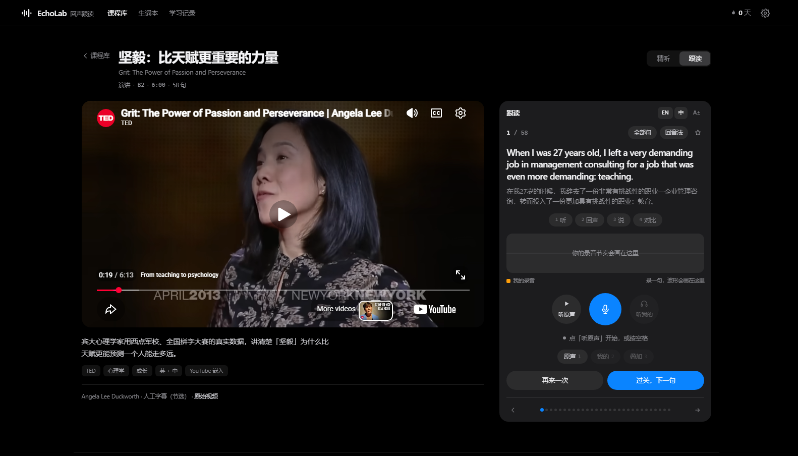
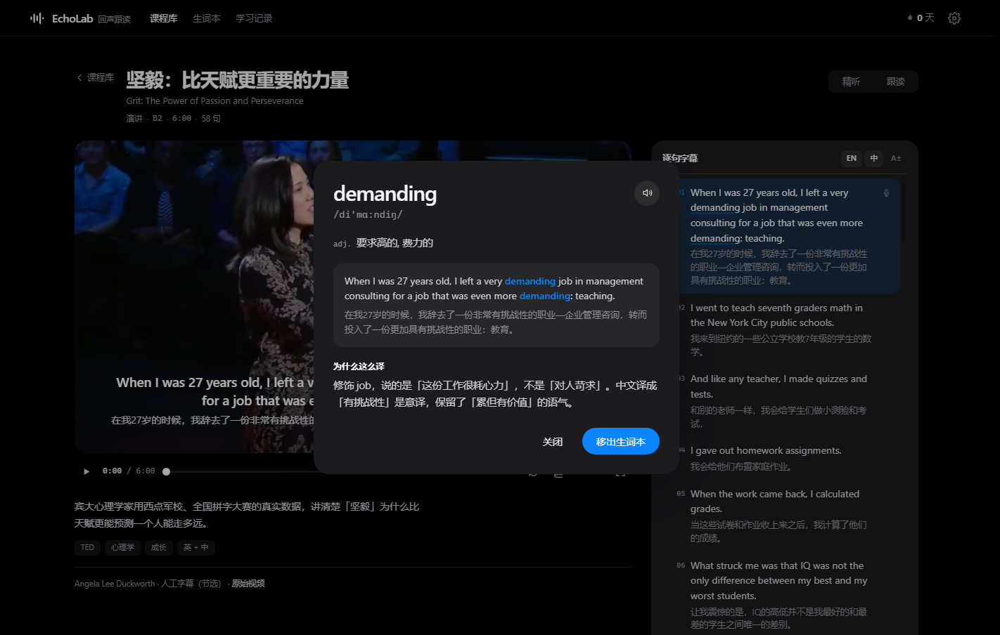
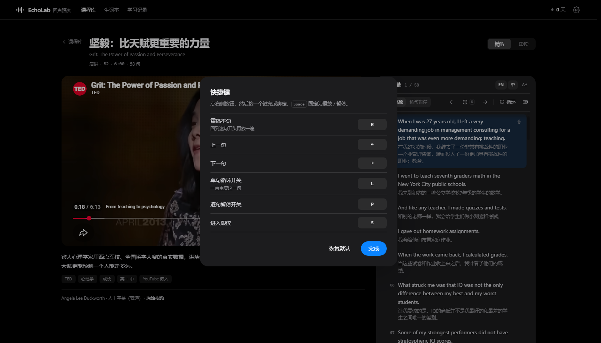
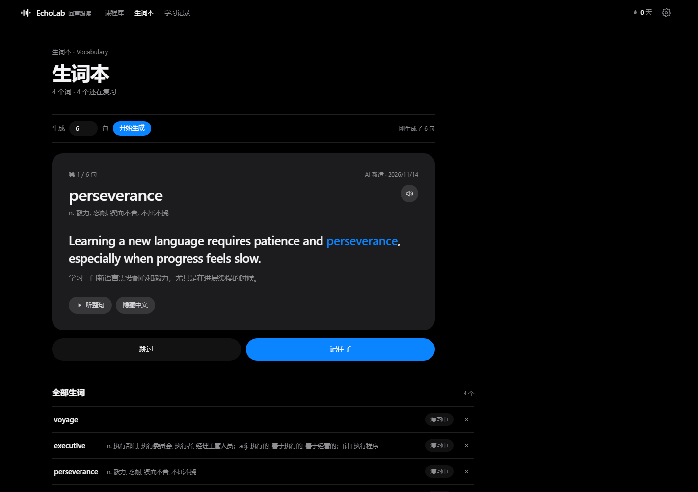

# EchoLab · 回声跟读

> 听见一句，就说出一句。
> 用真实英文演讲 / 访谈 / 学科短片，一个句子一个循环地练：**听 → 回声 → 说 → 对比**。

一个纯静态的网页端影子跟读（shadowing）练习器。参考 [VoiceTube](https://tw.voicetube.com/) 的逐句播放与跟读体验，把重心放在「把一句话说像」，而不是「看很多视频」。


---

## 快速开始

**方式一：双击（推荐，零依赖）**

- Windows：双击 `start.bat` —— 内置一个 PowerShell 静态服务器，**不需要安装 Python 或 Node**
- macOS / Linux：`bash start.sh`（用系统自带的 `python3 -m http.server`）

脚本会自动打开 `http://127.0.0.1:8777`。

**方式二：手动**

```bash
cd shadowing-app
python -m http.server 8777 --bind 127.0.0.1
# 浏览器打开 http://127.0.0.1:8777
```

> 必须通过 `http://localhost` 访问，**不要直接双击 index.html**：
> `file://` 下浏览器会禁用麦克风与 `fetch`，录音和字幕都会失效。

浏览器建议 Chrome / Edge 最新版（录音、Web Audio 支持最好）。

### 软件更新

Windows 上解压 Release 的 ZIP 后，用 `start.bat` 启动。打开网页时会检查一次更新，也可以在「设置 → 软件更新」手动检查。发现新版后，点「一键更新」即可下载、验证并安装，随后本地服务会重启并刷新网页。继续用同一个本地地址打开，浏览器里的进度、生词和设置会保留。

GitHub 仓库是私有的。更新服务使用本机已有的 Git for Windows 凭据，或启动前已设置的 `GH_TOKEN` / `GITHUB_TOKEN`。账号需要有仓库读取权限。Git 工作副本请用 `git pull` 更新，macOS / Linux 请从 Releases 下载新版 ZIP。

---

## 它有什么

| 模块 | 能力 |
| --- | --- |
| 课程库 | 7 节逐句精听和跟读课程，覆盖演讲 / 访谈 / 学科介绍；支持分类和关键词筛选 |
| 页面结构 | **左视频 / 右字幕**（约 84vw 宽）；精听 / 跟读在右栏切换 |
| 视频来源 | **YouTube 原生播放器**（IFrame Player API，自带控制条/倍速/全屏），仓库里不存任何视频文件 |
| 播放器 | YouTube 自带控制条（进度、音量、倍速、全屏） |
| 精听控制条 | `连续播放 / 逐句暂停`、`上一句`、`重播本句`、`下一句`、`单句循环`、`⌨ 快捷键设置` |
| 双语字幕 | 英文人工字幕 + 中文译文，可独立开关；点击任意单词看词卡 |
| 词卡 | 音标、中文释义、本句原句 + 中文翻译、**为什么这么译**、TTS 发音、收藏 |
| 跟读面板 | 听 → 回声（可调 1–5 秒）→ 说（录音）→ 对比；原声 / 我的 / 叠加三段回放 |
| 录音波形 | Web Audio 采集麦克风的 RMS 包络，画出你自己的节奏 |
| 两种模式 | 回音法（听完停顿再开口）/ 同步跟读（与原声同时开口） |
| 进度 | 每句「过关 / 再来一次」，课程进度、累计分钟、连续天数、热力图 |
| 收藏 | 收藏句子，可回跳到对应句子 |
| 生词本 | 独立标签页：**AI 现场造句**（一次 5–50 句），听整句 / 看译文 / 标记「记住了」后不再出现 |
| 外观 | Material 风格深色界面，适配桌面与移动端 |
| 数据 | 全部存本地 `localStorage`，可导出 JSON / 一键清空 |

**键盘**：`Space` 播放/暂停（固定），其余可在课程页点 **⌨** 自定义：默认 `←→` 上下句、`R` 重播本句、`L` 单句循环、`P` 逐句暂停、`S` 切到跟读；跟读页 `1 2 3` 三段回放、`↵` 过关；`?` 快捷键面板。









---

## 内容与字幕来源

产品需求里最硬的一条：**自动字幕会错，跟读跟着错**。
课程优先使用 YouTube 上的人工字幕。使用自动字幕的课程会标注来源。

| 课程 | 分类 | 难度 | 时长 | 字幕 |
| --- | --- | --- | --- | --- |
| Grit（Angela Duckworth, TED） | 演讲 | B2 | 6:00 | 英 + 中 |
| 10 Ways to Have a Better Conversation（TED） | 演讲 | B2 | 3:49 | 英 + 中 |
| The Benefits of a Bilingual Brain（TED-Ed） | 学科·语言学 | B1 | 5:04 | 英 + 中 |
| How Does the Stock Market Work?（TED-Ed） | 学科·经济学 | B1 | 4:30 | 英 + 中 |
| Your Body Language May Shape Who You Are（Amy Cuddy, TED） | 演讲 | C1 | 6:42（节选） | 英 + 中 |
| The Biggest Launch Since ChatGPT（Cleo Abram 访谈） | 访谈 | C1 | 68:21 | 英 + 中（AI 译） |
| The full-length interview with Elon Musk（The Economist） | 访谈 | C1 | 85:06 | 英文自动字幕 |

素材授权：TED / TED-Ed 为 **CC BY-NC-ND 4.0**，Big Think 为平台公开访谈。
本项目仅作个人学习与教学演示。**视频不落地**：所有片段都通过 YouTube 官方嵌入播放器逐流加载，仓库里只有字幕和封面；界面内标注作者、平台与许可。

### 词卡的数据从哪来

- `content/dict.json`：从 [ECDICT](https://github.com/skywind3000/ECDICT)（MIT）抽取本课程库用到的 1099 个词条，含音标与中文释义，**离线可用**。
- `content/glosses.json`：人工撰写的「重点词」注解 —— 为什么这个词在这句里这么译（比如 `executive function` 是「执行功能」不是「高管的」）。没有注解的词仍会显示词典释义和本句译文。

### 生词本的例句：AI 现场生成

生词本不再读本地例句，而是每次点「开始生成」都让模型现写，所以句子永远是新的。

1. 打开 **设置 → AI 造句**：
   - **接口地址**：到 `/v1` 为止，已预填 `https://opencode.ai/zen/go/v1`（任何 OpenAI 兼容接口都行）
   - **API Key**：填完先点「**刷新模型**」，会从 `/v1/models` 拉回该接口真正支持的模型 id 供你选
2. 选好模型后点「测试」，状态栏会显示 `连接成功 · 模型 · 回复「OK」`。
3. 回到生词本，选 1–50 句 → 开始生成（普通模型 10 句约 10 秒；带推理的模型会慢一些）。

> **模型名不能随便填。** 这类网关的模型 id 是它自己的命名（`deepseek-v4.1-flash`、`glm-5.3`、`gpt-6-luna`…），填 `gpt-4o-mini` 这类通用名会被拒绝。所以先「刷新模型」再选，别手打。

> **有些网关还要额外的请求头。** opencode 的 `/go/v1` 要求 `x-opencode-session`，缺了会回 `400 MissingSessionID`。前端对这个域名会自动带上一个随机 session id，其他接口不受影响。代理会把上游的错误原文透出来（例如 `Invalid credential（HTTP 401）`），照着提示改就行。

> **带推理的模型（deepseek / glm 等）会先「想」再答。** 如果 `max_tokens` 给小了，思考就把额度吃光、正文为空。应用已经把测试请求的额度提到 300，并在生成时按数量给足；遇到 `finish_reason: length` 会直接提示「输出被截断，把数量调小或换轻量模型」。想快就用名字里带 `flash` / `haiku` 的模型。

浏览器直连这类接口会被 CORS 拦住（预检请求返回 404），所以请求走本地服务的中转：`POST /api/ai` 由 `tools/serve.ps1` 转发，密钥只在内存与本机 `localStorage` 里，不经过任何第三方。
**注意：用 `python -m http.server` 启动时没有这个中转，AI 造句不可用。**

---

## 目录结构

```
shadowing-app/
├── index.html              应用外壳
├── start.bat / start.sh    一键启动
├── js/
│   ├── app.js              路由
│   ├── store.js            localStorage 状态（进度 / 生词 / 设置）
│   ├── data.js             课程数据访问
│   ├── ui.js               图标、tokenize、词卡、toast
│   ├── library.js          课程库
│   ├── lesson.js           课程页（精听 / 跟读 同屏）
│   ├── shadow-panel.js     跟读面板（状态机 + 录音 + 波形）
│   ├── keys.js             可自定义快捷键（默认值 / 归一化 / 匹配）
│   ├── ai.js               AI 造句（/api/ai 中转调用）
│   ├── words.js            生词本（AI 造句复习）
│   ├── progress.js         学习记录
│   ├── settings.js         设置
│   └── about.js            关于
├── styles/                 base / library / lesson / shadow / pages
├── content/
│   ├── manifest.json       课程索引
│   ├── dict.json           离线词典（1099 词）
│   ├── glosses.json        重点词「为什么这么译」
│   └── <id>/
│       ├── lesson.json     句子与时间轴
│       │   （不含视频：播放走 YouTube 嵌入）
│       └── poster.jpg
├── tools/
│   ├── build_lessons.py    内容管线（下载→剪辑→转码→对齐→生成 json）
│   ├── build_dict.py       从 ECDICT 抽取词典
│   └── serve.ps1           零依赖静态服务器（Range + /api/ai 代理）
└── docs/
    ├── PRD.md              产品需求文档（含 VoiceTube 功能拆解）
    └── method.md           影子跟读与回音法说明
```

---

## 加一节课

1. 在 `tools/build_lessons.py` 的 `LESSONS` 里加一条：

```python
{
    "id": "my-lesson",
    "yt": "<YouTube video id>",
    "title": "Original Title",
    "titleZh": "中文标题",
    "speaker": "Speaker · Channel",
    "category": "speech",      # speech | interview | subject | news
    "level": "B2",
    "clip": (30.0, 240.0),     # 可选，秒；None 表示全片
    "zh": True,                # 源站是否有中文人工字幕
    "desc": "一句话简介",
    "tags": ["TED", "沟通"],
}
```

2. 构建：

```bash
pip install yt-dlp imageio-ffmpeg
python tools/build_lessons.py my-lesson
python tools/build_dict.py        # 补上新出现的生词
```

3. 刷新页面即可（`manifest.json` 会自动合并更新）。

---

## 隐私

- 没有后端、没有账号、没有埋点。
- 录音由浏览器 `MediaRecorder` 生成，只存在于当前页面内存，关闭即销毁，不上传、不落盘。
- 学习数据只写在 `localStorage`，可在设置页导出或清空。

---

## 已知限制

- 首次录音需要授予麦克风权限；若被拒绝，仍可「听 + 跟读」，只是没有录音对比。
- 同步跟读建议戴耳机，否则外放声音会被麦克风收进去。
- 波形是**你自己录音的节奏包络**，不是发音评分。改用 YouTube 嵌入后跨域拿不到原声音轨，"原声 vs 我的" 双色对比取消了。
- 词卡的「为什么这么译」目前覆盖 34 个重点词；其余词只有词典释义与本句译文。
- AI 造句需要 `start.bat` 启动（带 `/api/ai` 中转）；`python -m http.server` 下该功能不可用。
- 生成的句子质量取决于所选模型；失败会在卡片位置给出错误原因和重试按钮。
- Safari 对 `audio/webm` 支持不一，会自动回退到 `audio/mp4`。
- 嵌入受制于视频作者：若作者禁止嵌入，播放区会直接给出「去 YouTube 看」的提示（Big Think 的部分视频就是这样，所以那一课换成了 TED 的 Amy Cuddy）。
- 使用 YouTube 原生控制条（`controls: 1`），倍速在播放器设置菜单里；YouTube 的标题栏与「更多视频」在暂停/悬停时出现，播放中自动淡出。
- **逐句暂停**靠 140ms 轮询判断句尾：到句尾先 `pauseVideo()` 再回退 60ms，避免停在半句上。
- 因为不要 YouTube 自带字幕，进入播放态会调用 `unloadModule('captions')` 关掉 CC，避免和我们下方的双语字幕重复。
